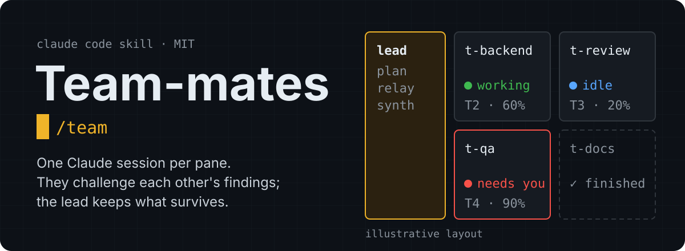

<p align="center">
  
</p>

**Team-mates** gives Claude Code a `/team` command. It runs a small team of Claude Code sessions on one task, each teammate a full interactive `claude` session in its own pane. Your session becomes the lead: it plans the roles with you, passes findings between teammates so they can challenge each other, and writes up what survives. It needs only standard Claude Code features (interactive sessions, cross-session messaging, subagents), so it works where the experimental [agent teams](https://code.claude.com/docs/en/agent-teams) feature is turned off.

## Install

```bash
npx skills add allexlima/team-mates-skill -g -a claude-code
```

This puts the skill in `~/.claude/skills/team`. Restart Claude Code and run `/team --help`.

Update with `npx skills update team -g` and remove with `npx skills remove team -g`.

<details>
<summary>Install from a git clone instead</summary>

```bash
git clone https://github.com/allexlima/team-mates-skill ~/team-mates-skill
mkdir -p ~/.claude/skills
ln -s ~/team-mates-skill/skills/team ~/.claude/skills/team
```

Update with `git -C ~/team-mates-skill pull`.
</details>

**Requirements:** [Claude Code](https://code.claude.com), `python3`, and [cmux](https://cmux.dev) (recommended) or tmux for the panes. With `--inline`, teammates run as subagents in your session and you need neither. Runs that edit code also use `git` and `gh`, plus [no-mistakes](https://github.com/kunchenguid/no-mistakes) if you have it.

## Try it

```text
/team review my current changes --autoroles
/team why does the streaming job lag? --roles 4 --rounds 2
/team add retry logic to the ingestion job and cover it with tests --autoroles
```

With `--autoroles`, the lead proposes roles from your repo and waits for your OK before starting anyone. Every flag and default is in `/team --help` ([HELP.md](skills/team/references/HELP.md)). Say **"shut down the team"** when you're done.

Each teammate is a full Claude session with its own context window, so cost grows with team size. Two or three sharp roles usually beat five vague ones.

## How it works

<p align="center">
  
</p>

1. **Plan.** The lead talks the task through with you, then writes back the roles, what is out of scope, and how the result gets checked. Nothing starts until you approve.
2. **Spawn.** Each role gets its own pane, titled `<team>-<role>`. Click into any pane to talk to that teammate. A teammate's questions go to the lead, which asks you in one place.
3. **Work.** `tasks.md` holds more tasks than there are teammates. A teammate that reports takes the next task in the same session. Each one splits its own work across subagents.
4. **Challenge.** Every teammate gets the others' findings and has to agree, dispute or refine them, with evidence.
5. **Synthesis.** The lead sorts the result into consensus, disputed, dropped and next steps. Verified findings go to `.team/facts.md` with their evidence, so the next run starts from what is already known.

When the task edits code in a git repo, each teammate also gets its own worktree, branch and commits. With no-mistakes installed, each branch goes through its gate and becomes one PR; without it, the commits stay local.

## The monitor

A status pane opens while the team runs. It shows overall task progress, a team ETA, and a **NEEDS YOU** block that pins any teammate needing attention, such as a dead session or one idle while ready work has no owner. `/team --help` lists every state. Teammates report their own percentages, so treat the progress and ETA as rough estimates.

## Project memory

The skill keeps its state in a git-ignored `.team/` folder at the project root:

```
.team/
├── facts.md                 verified findings: fact, evidence, date, run
├── roles/<role>.md          roles saved for this project
├── runs/<date>-<team>/      tasks.md · prompts/ · reports/ · status/ · synthesis.md
└── worktrees/               one per teammate on code-editing runs
```

It stores conclusions and pointers only, never secrets or raw data.

## Contributing

Only `skills/team/` ships. The lead's procedure is in [SKILL.md](skills/team/SKILL.md), the rules every teammate gets are in [teammate-rules.md](skills/team/references/teammate-rules.md), and commit and PR rules are in [git-practices.md](skills/team/references/git-practices.md). `tests/`, `CLAUDE.md` and `.githooks/` stay in the repo for development. Read [CLAUDE.md](CLAUDE.md) before changing anything: each fact has one owner file, and it lists the test suites to run before a merge.

## License

[MIT](LICENSE)
