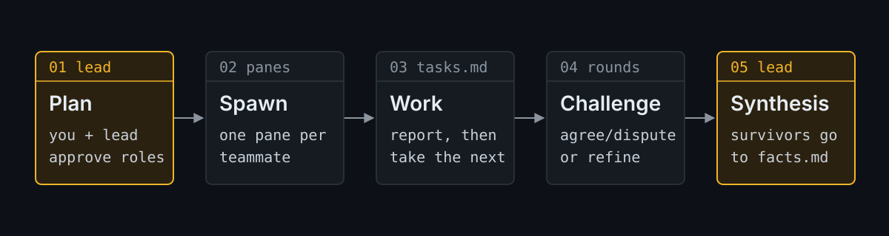

<p align="center">
  
</p>

`/team` runs a small team of Claude Code sessions on one task. Each teammate is a full, interactive `claude` session in its own pane. A lead session plans the roles, relays findings between teammates for challenge rounds, and writes the final synthesis. It uses only standard features (interactive sessions, cross-session messaging, subagents), so it works where Claude Code's experimental [agent teams](https://code.claude.com/docs/en/agent-teams) are disabled.

## What you get

- **A pane per teammate.** Each pane is titled `<team>-<role>`. Click into any of them and talk to that teammate directly.
- **One place for questions.** A teammate that needs your input sends it to the lead, which asks you in the lead pane, with options.
- **Challenge rounds.** Each teammate receives the others' findings and must agree, dispute, or refine them with evidence. The result is split into consensus, disputed, dropped, and next steps.
- **Build runs publish one PR per teammate.** In a git repo, each teammate gets its own worktree and branch, commits its own work, and passes it through a [no-mistakes](https://github.com/kunchenguid/no-mistakes) gate. One PR per teammate.
- **Memory that stays in the project.** Roles, run records, and a `facts.md` ledger of verified findings live in a git-ignored `.team/` folder, so later runs start from what is already known.
- **`--autoroles`.** The lead derives roles from your project, shows the roster, and waits for your approval before spawning anyone.

## How it works

<p align="center">
  
</p>

1. **You and the lead plan.** The lead brainstorms the task with you, then writes back the roles, what is out of scope, and how the result gets checked. Nothing spawns until you approve.
2. **Teammates start in panes.** Each role gets its own session. For larger tasks the lead proposes an optional tech lead and product manager. You keep or drop them with the roster.
3. **Each teammate fans out.** It splits its own work across subagents, checks what they return, and writes its report to `.team/runs/`.
4. **Work comes from a backlog.** `tasks.md` holds more tasks than teammates. A teammate that reports takes the next fitting task in the same session.
5. **The monitor tracks progress.** It shows overall task progress and a team ETA. See [The monitor](#the-monitor).
6. **Build runs publish through a gate.** Each teammate's branch goes through the no-mistakes gate and becomes a PR, opened with `gh`.
7. **The lead synthesizes.** Findings that survive the challenge rounds go to `.team/facts.md` with their evidence. A stale fact is struck through with a pointer to the run that contradicted it, and never deleted.

## The monitor

While a team runs, a status pane opens and repaints as its state changes. Its headline is the overall task progress: finished tasks, plus each open task's share as its owner reports it. Next to it is a team ETA, a linear extrapolation from the time elapsed so far. Finished teammates fold into one line, a backlog line shows what is still pending, and a teammate that is idle while ready work has no owner is pinned under **NEEDS YOU**.

The percentages are self-reported. Each teammate writes its own estimate, so the overall % and the ETA are rough indications, not measurements. In cmux, click a row or press its number to focus that teammate's pane. The pane closes itself once the last teammate finishes. `team.sh status <team>` prints one frame of the same view.

## Install

```bash
git clone https://github.com/allexlima/claude-code-team ~/.claude/skills/team
```

Start (or restart) Claude Code and run `/team --help`.

**Try it:** `/team review my current changes --autoroles`. The lead proposes roles from your repo, you approve, and the team runs.

**Update:** `git -C ~/.claude/skills/team pull` · **Uninstall:** `rm -rf ~/.claude/skills/team`

### Requirements

| | |
|---|---|
| Required | [Claude Code](https://code.claude.com) and `python3`. For panes, [cmux](https://cmux.dev) (default and recommended) or tmux as a fallback. `--inline` needs neither. |
| Build runs | `git`, an `origin` remote, and `gh` for opening PRs. [no-mistakes](https://github.com/kunchenguid/no-mistakes) is optional; without it, commits stay local. |
| Optional | [caveman](https://github.com/JuliusBrussee/caveman) installed at `~/.agents/skills/caveman` for terse teammate output (skipped if absent). |

## Usage

```
/team <task> [options]
```

```text
/team review PR #42 for security, performance and test coverage
/team why does the streaming job lag? --roles 4 --rounds 2 --model sonnet
/team review my current changes --autoroles
/team add retry logic to the ingestion job and cover it with tests --autoroles
/team research vector search options for our RAG demo --tabs --autoclose
```

Name roles yourself if you like: `Roles: security: auth + tokens, perf: DB queries, skeptic: challenge the others`. Saved roles load by name, first from the project (`.team/roles/`), then from your shared library (`~/.claude/team/roles/`).

Every flag and default is listed by `/team --help` and in [HELP.md](HELP.md). This README does not repeat them. When you're done, say **"shut down the team"**.

## Team shape

For anything beyond a very basic task, the lead proposes a **tech lead** (opus). The tech lead owns the backlog, assigns tasks, reviews, and merges. It also proposes a **product manager** (sonnet) when scope or acceptance criteria are fuzzy. Once a tech lead exists, it is the single authority for assigning backlog tasks.

## Build runs

Build runs edit code, so they publish. Each teammate works like a separate person: its own worktree, its own branch (`team/<team>-<role>`, or the project's own convention when its `CLAUDE.md` defines one), its own commits, and its own no-mistakes gate. The lead asks once per run who merges the PRs: the tech lead with `gh`, after review and green checks, or you.

Commit and PR rules come from [git-practices.md](git-practices.md): Conventional Commits, one logical change per commit, and PRs kept under about 200 changed lines. Larger changes go in a chain of PRs, each based on the one before it. Judgment calls are forwarded to the lead, and you answer them in the lead pane.

## Permissions and models

Teammates start in auto permission mode with a pre-approved allowlist of routine local commands: reads, edits, git inspection and commits, tests, and linting. It is a convention, not a hard block. Under auto mode an unlisted command can still run. Pushes, `gh` writes, installs, deploys, and destructive commands are left off the list and go through the tech lead or the lead.

The lead fits a model to each role, using the cheapest tier that still suits it. `--model` forces one model everywhere. Haiku-tier teammates run unattended in dontAsk mode with a per-teammate allowlist, and they are refused on build runs.

## Project memory: `.team/`

Created at the project root on first run. It is git-ignored, along with `CLAUDE.local.md`, and a one-time pointer is added to `CLAUDE.local.md`, never to `CLAUDE.md`.

```
.team/                       (git-ignored)
├── facts.md                 verified findings: fact, evidence, date, run
├── roles/<role>.md          project roles (override the shared library)
├── runs/<date>-<team>/      tasks.md · prompts/ · reports/ · status/ · synthesis.md
└── worktrees/               build-run worktrees
```

Only conclusions and pointers are stored: never secrets, PII, or raw data. A shared role library in `~/.claude/team/roles/` can be synced across machines; `team.sh roles` lists what is available and how each copy differs.

## Where teammates appear

- **cmux (default, recommended).** Your tab splits: you and the lead on the left, teammates in a two-column grid on the right. Finished teammates close. Install from [cmux.dev](https://cmux.dev).
- **tmux (fallback).** Used when you run `/team` inside tmux but not cmux. The grid is the same, but the monitor is lighter: it can't show waiting or idle states, there is no sidebar pill, and its rows can't be clicked.
- **`--inline`.** No panes. Teammates run as subagents inside your session, so no cmux or tmux is needed.

UI checks run in Google Chrome through the Chrome DevTools MCP.

## Good to know

- **Cost scales with team size.** Every teammate is a full Claude session with its own context window. Two or three sharp roles beat five vague ones.
- **Permission prompts appear in the teammate's own pane.** A teammate's questions go to the lead instead, which relays them to you in one place.
- **Later challenge rounds resume.** A finished teammate's session is resumed when it is still recorded. Otherwise a fresh teammate reads its earlier report.
- **First time in a folder**, each pane may show Claude's workspace-trust prompt.
- Tested on macOS with cmux.

## Documentation

- [HELP.md](HELP.md) (`/team --help`): options, defaults, model choice, and monitor keys.
- [SKILL.md](SKILL.md): the lead's procedure, step by step.
- [teammate-rules.md](teammate-rules.md): what every teammate is told.
- [git-practices.md](git-practices.md): commits, PR size, and `gh` on build runs.

## License

[MIT](LICENSE)
