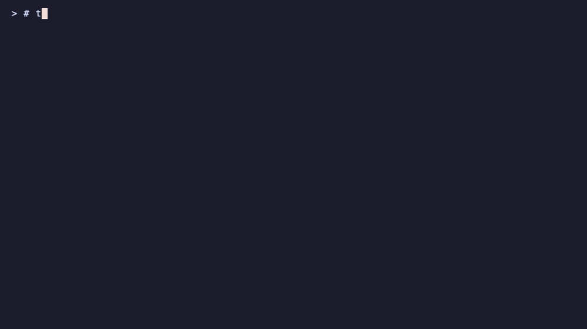
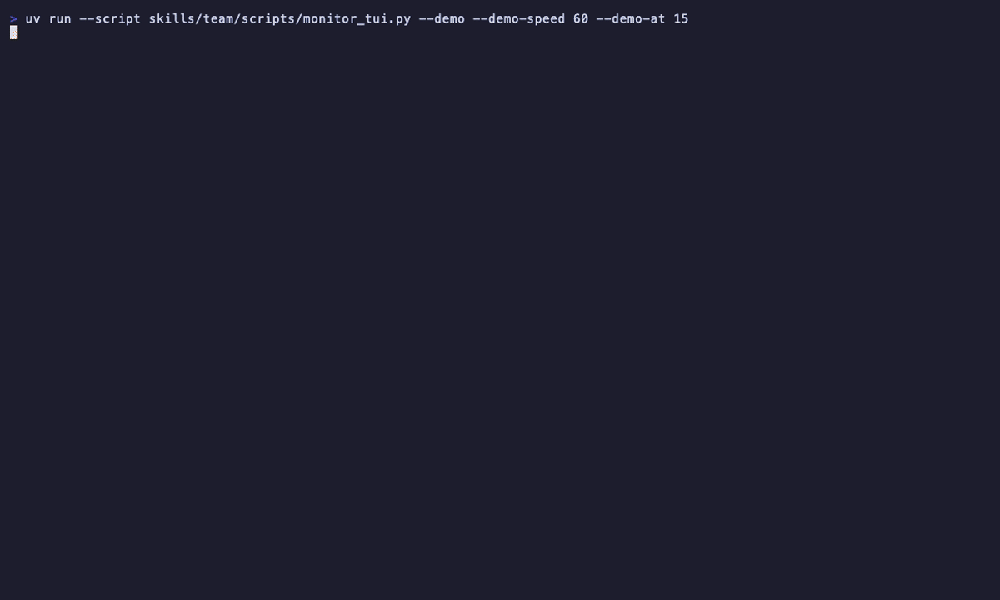

<p align="center">
  
</p>

**Team-mates** gives Claude Code a `/team` command. Your session becomes the lead of a small team of Claude Code sessions, each in its own pane. The lead plans the roles with you, passes findings between teammates so they can challenge each other, and writes up what survives. It uses only standard Claude Code features (interactive sessions, cross-session messaging, subagents), so it works where the experimental [agent teams](https://code.claude.com/docs/en/agent-teams) feature is turned off.

<p align="center">
  <a href="#install">Install</a> ·
  <a href="#try-it">Try it</a> ·
  <a href="#how-it-works">How it works</a> ·
  <a href="#the-monitor">Monitor</a> ·
  <a href="#project-memory">Memory</a> ·
  <a href="#contributing">Contributing</a>
</p>

## Install

```bash
npx skills add allexlima/team-mates-skill -g -a claude-code
```

This puts the skill in `~/.claude/skills/team`. Restart Claude Code and run `/team --help`.

Update with `npx skills update team -g` and remove with `npx skills remove team -g`.

<details>
<summary>Install from a git clone instead</summary>

```bash
git clone https://github.com/allexlima/team-mates-skill ~/team-mates-skill
mkdir -p ~/.claude/skills
ln -s ~/team-mates-skill/skills/team ~/.claude/skills/team
```

Update with `git -C ~/team-mates-skill pull`.
</details>

**Requirements:** [Claude Code](https://code.claude.com), `git`, `python3`, and [cmux](https://cmux.dev) (recommended) or tmux for the panes. With `--inline`, teammates run as subagents in your session and you need neither pane tool. Optional: superpowers (brainstorming), humanizer, beautify-github-readme, diagram-design, caveman, the Chrome DevTools MCP with Google Chrome stable, the [no-mistakes](https://github.com/kunchenguid/no-mistakes) CLI, and `gh` for build runs that open PRs. Each is used when installed and skipped when not; [`/team --help`](skills/team/references/HELP.md#optional-dependencies) lists what a run loses without each.

## Try it

```text
/team review my current changes --autoroles
/team why does the streaming job lag? --roles 4 --rounds 2
/team add retry logic to the ingestion job and cover it with tests --autoroles
```

<p align="center">
  
</p>

With `--autoroles`, the lead proposes roles from your repo and waits for your OK before starting anyone. Every flag and default is in `/team --help` ([HELP.md](skills/team/references/HELP.md)). Say **"shut down the team"** when you're done.

Each teammate is a full Claude session with its own context window, so cost grows with team size. Two or three sharp roles usually beat five vague ones.

## How it works

<p align="center">
  
</p>

1. **Plan.** The lead talks the task through with you, then writes back the roles, what is out of scope, and how the result gets checked. Nothing starts until you approve.
2. **Spawn.** Each role gets its own pane, titled `<team>-<role>`. Click into any pane to talk to that teammate. A teammate's questions go to the lead, which asks you in one place.
3. **Work.** `tasks.md` holds more tasks than there are teammates. A teammate that reports takes the next task in the same session. Each one splits its own work across subagents.
4. **Challenge.** Every teammate gets the others' findings and has to agree, dispute or refine them, with evidence.
5. **Synthesis.** The lead sorts the result into consensus, disputed, dropped and next steps. Verified findings go to `.team/facts.md` with their evidence, so the next run starts from what is already known.

When the task edits code in a git repo, each teammate also gets its own worktree, branch and commits. With no-mistakes installed, each branch goes through its gate and becomes one PR; without it, the commits stay local.

## The monitor

A status pane opens next to the teammates while the team runs. With [Textual](https://textual.textualize.io) importable (or `uv` installed) it is a full-screen TUI: a card per live teammate, the backlog with a progress bar and ETA per task, an event log, and a **NEEDS YOU** block for anything that wants your attention. Otherwise you get a plain-text pane with the same states. `/team --help` ([HELP.md](skills/team/references/HELP.md)) lists the states, keys and settings.

<p align="center">
  
</p>
<p align="center"><sub>Illustrative demo: a synthetic team played by <code>monitor_tui.py --demo</code>, not a real run. Re-record with <code>vhs assets/readme/tapes/monitor.tape</code>.</sub></p>

Teammates report their own percentages, so treat the progress and ETA as rough estimates. Try the monitor without a team: `uv run --script skills/team/scripts/monitor_tui.py --demo`.

## Project memory

The skill keeps its state in a git-ignored `.team/` folder at the project root. It stores conclusions and pointers only, never secrets or raw data.

<details>
<summary>What is in <code>.team/</code></summary>

```
.team/
├── facts.md                 verified findings: fact, evidence, date, run
├── roles/<role>.md          roles saved for this project
├── runs/<date>-<team>/      tasks.md · prompts/ · reports/ · status/ · synthesis.md
└── worktrees/               one per teammate on code-editing runs
```
</details>

## Contributing

Only `skills/team/` ships. The lead's procedure is in [SKILL.md](skills/team/SKILL.md), the rules every teammate gets are in [teammate-rules.md](skills/team/references/teammate-rules.md), and commit and PR rules are in [git-practices.md](skills/team/references/git-practices.md). `tests/`, `CLAUDE.md` and `.github/` stay in the repo for development. Read [CLAUDE.md](CLAUDE.md) before changing anything: it holds the branch workflow (branch from `dev`, PR into `dev`, CI must be green), the one-owner-per-fact rule and the test suites to run before a merge.

## License

[MIT](LICENSE)
